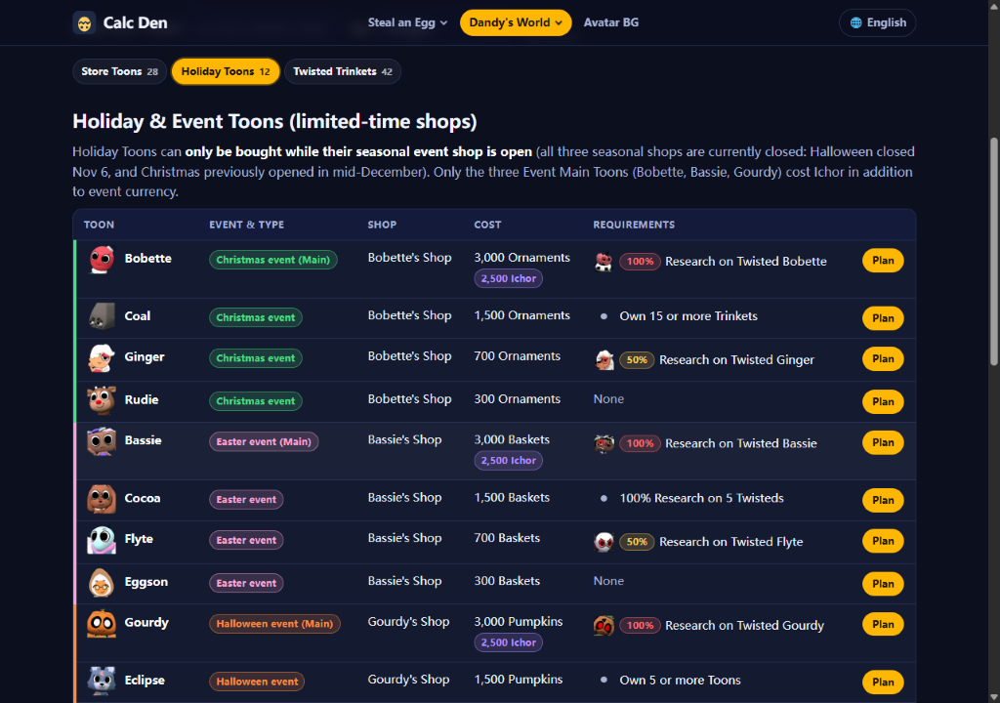

# Roblox Reference Notes & Zero-Dependency Utilities (Dandy's World + Avatar Backgrounds)

Two standalone Node.js modules and quick-reference tables for Roblox players and creators:

1. [`dandys-world-math.mjs`](./dandys-world-math.mjs) — Research floor counts (normal vs. Rodger) and per-run Ichor math for Dandy's World.
2. [`avatar-bg-header-check.mjs`](./avatar-bg-header-check.mjs) — Binary header checker (PNG / JPG / BMP / TGA) that validates Roblox's 2560×1440, no-alpha, sRGB Avatar Background upload rules before you spend 200 Robux.

---

## 1. Dandy's World: Research Floors, Ichor Per Run & Holiday Prices

### Research Floor Formula
Each floor where a target Twisted spawns gives:
- **Encounter bonus:** `+5%`
- **Research Capsules:** `+1%` each (normally 2 capsules per Twisted per floor → **`+7%` max/floor**)
- **Rodger passive:** doubles both (`+10%` encounter + `2 × 2%` capsules → **`+14%` max/floor**)

```text
floors_needed = ceil(max(0, target_pct - current_pct) / (base_pct * (rodger ? 2 : 1)))
```

| Research Goal | Normal (7%/floor) | Using Rodger (14%/floor) |
|---|---:|---:|
| 0% → 25% (Brusha) | 4 floors | 2 floors |
| 0% → 50% (Ginger / Flyte / Soulvester / regular 50% Toons) | 8 floors | 4 floors |
| 0% → 100% (Mains, Holiday Mains, Trinkets) | 15 floors | 8 floors |

### Ichor Per Run Formula
```text
ichor_per_run = 5 * min(floors, 15)
              + 6 * max(floors - 15, 0)
              + 5 * machines
              + 2 * capsules
              + 5 * min(ability_uses, floors)
```

### Seasonal Holiday Shop Pricing Pattern (12 Event Toons)
Christmas (**Bobette's Shop** / Ornaments), Easter (**Bassie's Shop** / Baskets), and Halloween (**Gourdy's Shop** / Pumpkins) all share the same 4-tier ladder (5,500 event currency + 2,500 Ichor to clear one seasonal shop):

| Tier | Event Currency | Ichor | Requirement Pattern | Examples |
|---|---:|---:|---|---|
| Starter holiday Toon | 300 | 0 | None | Rudie, Eggson, Ribecca |
| Mid holiday Toon | 700 | 0 | 50% Twisted Research | Ginger, Flyte, Soulvester |
| Upper holiday Toon | 1,500 | 0 | Collection / Research milestone | Coal (15 Trinkets), Cocoa (5× 100% Research), Eclipse (5 Toons) |
| Holiday Main | 3,000 | 2,500 | 100% Twisted Research | Bobette, Bassie, Gourdy |

Run the quick check:
```bash
node dandys-world-math.mjs
```

Browser tools: [Dandy's World Toons & Trinkets](https://calcdenhq.com/dandys-world/toon-unlocks/) · [Dandy's World Ichor & Research Planner](https://calcdenhq.com/dandys-world/research-unlock-planner/)



---

## 2. Roblox Avatar Background 2560×1440 Binary Header Validator

Roblox's Avatar Backgrounds (200 Robux upload fee, 1 upload/day, ID-verified + Roblox Plus) enforce strict binary constraints:

| Rule | Requirement | Common Failure Cause |
|---|---|---|
| Dimensions | Exactly `2560 × 1440` px (16:9) | Off-by-one canvas exports |
| File format | `JPG`, `PNG`, `TGA`, or `BMP` | Uploading WebP or PSD |
| Alpha channel | **Forbidden** (even if 100% opaque) | PNG colorType `4`/`6`, PNG `tRNS` chunk, 32-bit BMP/TGA |
| Color profile | `sRGB` | Display P3 / Adobe RGB embedded in `iCCP` / `cICP` / `APP2` |

### Measured Screen Crop Fractions (`[left, top, right, bottom]`)
Roblox wraps the image onto a curved studio cyclorama in 3D and crops differently per viewport. Community creator measurements on the Nov 2026 launch thread:

| Screen | Horizontal Visible | Vertical Visible | Notes |
|---|---|---|---|
| Web Profile Banner | `13.6% – 86.4%` | `38.1% – 77.8%` | Tight horizontal strip; cuts sky & floor |
| Tablet Editor | `16.5% – 83.5%` | `19.8% – 99.0%` | More vertical height, trims sides |
| Phone Editor | `21.9% – 77.9%` | `19.8% – 100.0%` | Narrowest side crop |
| Square Thumbnail | `36.5% – 63.3%` | `36.7% – 84.4%` | Tight crop around avatar center |

Validate any local file from the terminal:
```bash
node avatar-bg-header-check.mjs path/to/your-background.png
```

Browser overlay preview & 1-click 2560×1440 JPG fix: [Avatar Background 2560×1440 Checker](https://calcdenhq.com/roblox-avatar-background-template/)


---

## License & Attribution

- JavaScript code in this repository: **MIT License**.
- Dandy's World Toon, Research, and Holiday shop data: [Dandy's World Wiki (Fandom)](https://dandys-world-robloxhorror.fandom.com/wiki/Dandy%27s_Store), licensed under [CC BY-SA 3.0](https://creativecommons.org/licenses/by-sa/3.0/).
- Roblox Avatar Background upload specifications: Roblox Developer Forum launch announcement (Nov 2026); screen crop coordinates from community creator measurements.
- Companion repo for Steal an Egg math: [steal-an-egg-formulas](https://github.com/duanrh/steal-an-egg-formulas) · Blog write-ups: [Calc Den Game Notes](https://calcden-notes.blogspot.com/).
