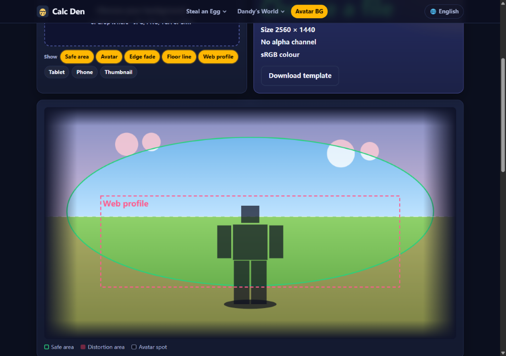

# Roblox Game & Creator Reference Notes (Dandy's World + Avatar Backgrounds)

Quick reference notes for two things Roblox players and creators keep running into:

1. **Dandy's World Toon & Holiday Unlock Costs** — all 12 seasonal Toons (Christmas, Easter, Halloween) plus the 5 regular Store Mains, Research floor math with vs. without Rodger.
   - Interactive Toon price table: [Dandy's World Toons & Trinkets](https://calcdenhq.com/dandys-world/toon-unlocks/)
   - Run & floor estimator: [Dandy's World Ichor & Research Planner](https://calcdenhq.com/dandys-world/research-unlock-planner/)

2. **Roblox Avatar Background 2560×1440 Specs** — why solid PNGs still fail with hidden alpha channels, and how the web profile strip crops tighter than phone/tablet editors.
   - Local header & safe-area pre-check: [Avatar Background 2560×1440 Checker](https://calcdenhq.com/roblox-avatar-background-template/)

---

Related repo for Steal an Egg math: [steal-an-egg-formulas](https://github.com/duanrh/steal-an-egg-formulas).
Blog write-ups: [Calc Den Game Notes](https://calcden-notes.blogspot.com/).
